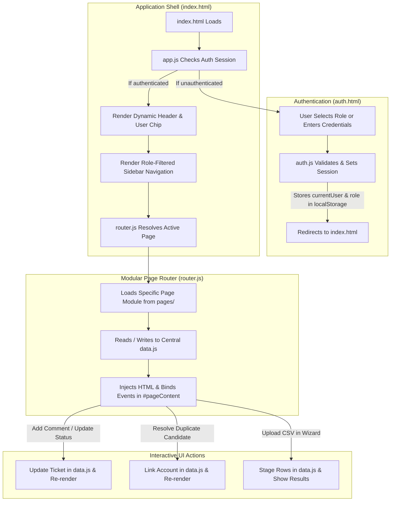

# HVAC Connect — Frontend Screens & Architecture Implementation Plan

> **Scope:** Pure HTML5, CSS3, and Vanilla JavaScript (ES6+ Modules)  
> **Backlog Authority:** Aligned directly with `PBL.xlsx` (`PB-001` through `PB-009`) and `SPL.xlsx` (`US001` through `US009`)  
> **Key Architecture Decision:** Modular multi-file design — dedicated page and component files orchestrated through `index.html` rather than a single monolithic file.

---

## 1. Modular Folder & File Architecture

To keep the codebase maintainable, clean for pair programming, and scalable for a team project, we organize the `Frontend/` directory as follows:

```
Frontend/
│
├── index.html                  <-- Master Application Shell (Header, Sidebar, Breadcrumbs, Main Viewport, Modals, Toast)
├── auth.html                   <-- Standalone Authentication Page (Login, Register, Forgot Password)
│
├── css/
│   ├── main.css                <-- Global design tokens, layout grid, typography, tables, badges, cards, buttons, utilities
│   ├── auth.css                <-- Dedicated stylesheet for auth.html (split out from internal <style>)
│   ├── components.css          <-- Reusable UI elements: modals, tabs, steppers, timelines, search/filter bars, toast
│   └── mobile.css              <-- Responsive overrides for phone/tablet widths (especially for Technician mobile UI)
│
├── js/
│   ├── auth.js                 <-- Session management, login/logout logic, role persistence (localStorage), auth guard
│   ├── data.js                 <-- Centralized Mock Data Store (__PRESERVE_CONTRACTOR_8__, Customers, Sites, Assets, Tickets, Comments, Duplicates)
│   ├── router.js               <-- Page dispatcher & dynamic content loader (renders requested page into #pageContent)
│   └── app.js                  <-- Application coordinator: initializes navigation, binds global events, search & toast notifications
│
└── pages/                      <-- Modular Page Renderers (each file exports a clean render function)
    ├── superadmin-dashboard.js <-- Group Overview, contractor portfolio, onboarding progress, quality metrics (PB-003)
    ├── contractor-dashboard.js     <-- Contractor-scoped operations, local tickets, SLA breaches, technician summaries (PB-004)
    ├── coordinator-dashboard.js<-- Service Coordinator priority queue, real-time SLA countdowns, dispatch reminders (PB-005)
    ├── technician-dashboard.js <-- Mobile-optimized field worker dashboard, assigned work, profile strip (PB-009)
    ├── enduser-dashboard.js    <-- Facility manager portal, my equipment, recent service requests, quick actions
    ├── contractors.js              <-- Contractor/Contractor registry, status tracking, create contractor modal
    ├── customers.js            <-- Canonical customer registry, customer profile, linked contractor accounts, location history (PB-020, PB-022)
    ├── locations.js            <-- Customer sites, site hierarchy (Campus/Building/Floor), access instructions
    ├── assets.js               <-- HVAC & Refrigeration Equipment catalogue (RTU, Chiller, Boiler, Walk-in, Rack) (PB-008)
    ├── technicians.js          <-- Technician roster, specializations, employee codes, active ticket counts
    ├── tickets.js              <-- Shared ticket register, multi-criteria filters (Status, SLA, Priority), create ticket modal (PB-007)
    ├── ticket-detail.js        <-- Ticket detail, lifecycle stepper, technician comment thread, resolution/closure modal
    ├── imports.js              <-- 5-stage CSV Import Wizard (Upload, Map, Preview, Validate, Stage) (PB-006)
    ├── duplicates.js           <-- Rule-based duplicate review queue, side-by-side comparison, Link/Separate actions (PB-028, PB-029)
    ├── onboarding.js           <-- Contractor Onboarding checklist (Phase 1 Coexistence & Phase 2 Cutover) (PB-030)
    ├── audit.js                <-- System audit logs and compliance event stream
    └── error-pages.js          <-- Standardized 403 (Forbidden), 404 (Not Found), 500 (Error) screens (PB-001)
```

---

## 2. Exhaustive List of Screens in Scope

Every screen is mapped directly to its user story in the Product Backlog (`PBL.xlsx`) and Sprint Backlog (`SPL.xlsx`):

| # | Screen Name | PBL / SPL ID | Target Roles | Key Features & Mock Functionalities |
|---|---|---|---|---|
| **1** | **Login & Authentication** | `PB-002` / `US002` | All (5 Roles) | • Clean modern login card with email and password inputs.<br/>• Show/Hide password toggle.<br/>• Form validation with user-friendly error banners.<br/>• Stores current session and role in `localStorage` and redirects to `index.html`. |
| **2** | **Registration / Sign Up** | `PB-002` / `US002` | End User / Tech | • Self-service account registration with full name, work email, account type, and password confirmation.<br/>• Client-side password matching validation. |
| **3** | **Forgot Password & Reset** | `PB-002` / `US002` | All | • Email entry screen with confirmation banner: *"Password reset instructions have been sent to your registered email address."* |
| **4** | **Super Admin (Group) Dashboard** | `PB-003` / `US003` | Super Admin | • Group-wide KPI summary cards (Total __PRESERVE_CONTRACTOR_9__, Canonical Customers, Locations, HVAC Assets).<br/>• Contractor Portfolio table with region, onboarding phase, and progress bar.<br/>• Data Quality Snapshot (Missing serial numbers, duplicate candidates, pending re-imports).<br/>• Recent Activity stream. |
| **5** | **Contractor Management Dashboard** | `PB-004` / `US004` | __PRESERVE_CONTRACTOR_1__ | • Scoped to contractor (e.g., *Pacific Climate Services*).<br/>• Operational KPIs: Open tickets, SLA breaches, tickets at risk, monthly closed jobs.<br/>• "Tickets Requiring Immediate Attention" mini-table.<br/>• Local technician roster summary. |
| **6** | **Service Coordinator Dashboard** | `PB-005` / `US005` | Coordinator | • **Priority Dispatch Queue** displaying remaining SLA time, priority badges, and assigned technicians.<br/>• **SLA Risk Monitor**: Tickets categorized by `Within SLA`, `At Risk` (amber countdown), and `Breached` (red alert).<br/>• Coordinator Follow-up action cards (Escalate breached tickets, confirm technician ETA). |
| **7** | **Field Technician Mobile Dashboard** | `PB-009` / `US009` | Technician | • Responsive, mobile-first technician profile strip (Name, Employee ID, assigned region, specialization).<br/>• Daily job summary (Assigned, In Progress, Completed Today, Due Today).<br/>• "My Assigned Tickets" cards with immediate action buttons (*Start Work*, *Update Status*, *Close*). |
| **8** | **End User (Customer) Portal** | `PB-005` / Wireframes | End User | • Customer facility overview: My Registered Assets, Open Service Requests, Completed History.<br/>• Quick actions: *Raise a Service Ticket*, *Track Requests*, *Browse Equipment*.<br/>• Equipment warranty status overview. |
| **9** | **Ticket Register (Shared Queue)** | `PB-007` / `US007` | Super Admin, __PRESERVE_CONTRACTOR_2__, Coordinator, End User | • Full searchable ticket table with real-time text filter.<br/>• Multi-dropdown filters: by Status (`Open`, `Assigned`, `In Progress`, `Resolved`, `Closed`), SLA state (`Within SLA`, `At Risk`, `Breached`), and Priority.<br/>• "+ Create Ticket" button opening an interactive modal. |
| **10** | **Ticket Detail & Comment Thread** | `PB-007` / `US007` | All Roles | • Complete ticket overview with customer, location, equipment tag, and SLA countdown.<br/>• **Visual Lifecycle Stepper**: `Open` $\rightarrow$ `Assigned` $\rightarrow$ `In Progress` $\rightarrow$ `Resolved` $\rightarrow$ `Closed`.<br/>• **Technician Comment Thread**: Real-time interactive comment box where technicians and dispatchers post updates and notes.<br/>• **Ticket Resolution Modal**: Form to submit work performed, diagnostics, and final closure notes. |
| **11** | **Customer Registry** | `PB-019`, `PB-020` / `US018` | Super Admin, __PRESERVE_CONTRACTOR_3__ | • Canonical customer table with group IDs (`CUST-00128`), linked contractor accounts count, and status.<br/>• Search and filter by customer type (`Commercial`, `Retail`, `Healthcare`).<br/>• "+ Add Customer" modal. |
| **12** | **Customer Profile & Location History** | `PB-020`, `PB-022` / `US019`, `US021` | Super Admin, __PRESERVE_CONTRACTOR_4__ | • Customer detail tabs: *Overview*, *Contractor Accounts*, *Customer Locations*.<br/>• Linked local account numbers across acquired contractors (e.g. `PCS-104`, `NCG-209`).<br/>• **Customer Location Change Timeline** (PB-022 history tracking). |
| **13** | **Customer Sites / Locations** | `PB-021` / `US020` | Coordinator, __PRESERVE_CONTRACTOR_5__ | • Grid of serviced site cards with address, operating hours, asset counts, and active status.<br/>• Location hierarchy view (Campus $\rightarrow$ Building $\rightarrow$ Floor).<br/>• Site technician access instructions callout. |
| **14** | **HVAC Asset Catalogue** | `PB-008`, `PB-023` / `US008`, `US022` | All Roles | • Card-based equipment catalogue supporting the 5 core MVP categories: **Rooftop Units (RTU)**, **Chillers (CH)**, **Boilers (BLR)**, **Walk-in Coolers/Freezers (WIK)**, and **Refrigeration Racks (RCK)**.<br/>• Equipment details modal with manufacturer, serial number, refrigerant type, and warranty expiration indicator. |
| **15** | **Technicians & Workers Roster** | `PB-004`, `PB-009` / `US004` | Super Admin, __PRESERVE_CONTRACTOR_6__, Coordinator | • Roster table displaying technician names, employee IDs (`TECH-104`), affiliated contractor, HVAC specializations, active assigned tickets, and availability status. |
| **16** | **Contractor Management Directory** | `PB-017`, `PB-018` / `US016`, `US017` | Super Admin | • Master contractor table showing contractor code (`PCS-001`), legal name, region, assigned customer locations, onboarding phase, and status (`Active`, `Pending Onboarding`).<br/>• "+ Add Contractor" modal. |
| **17** | **Data Import Wizard (5 Stages)** | `PB-006`, `PB-024` to `PB-027` / `US006` | Super Admin | • Interactive 5-step stepper: **1. Select Source** $\rightarrow$ **2. Map Columns** $\rightarrow$ **3. Preview** $\rightarrow$ **4. Validate** $\rightarrow$ **5. Stage & Complete**.<br/>• Drag-and-drop CSV file selector.<br/>• Interactive column mapping preview (`Source Column` $\rightarrow$ `Platform Field`).<br/>• Validation feedback table highlighting valid rows, warnings, and formatting errors.<br/>• History of previous import jobs with status badges. |
| **18** | **Duplicate Review Queue** | `PB-028`, `PB-029` / `US049` | Super Admin | • Duplicate candidate list flagged by the rule-based engine with confidence badges (**90% High**, **70% Medium**) and match explanations.<br/>• **Side-by-Side Comparison Card**: Record A (Existing Canonical Customer) vs Record B (Imported Candidate).<br/>• Action buttons: **"Link to Customer"**, **"Keep Separate"**, **"Defer"** with instant UI updates. |
| **19** | **Contractor Onboarding Tracker** | `PB-030` / `US047` | Super Admin | • Visual stage stepper: *Discovery* $\rightarrow$ *Mapping* $\rightarrow$ *Validation* $\rightarrow$ *Approval* $\rightarrow$ *Phase 1 Live* $\rightarrow$ *Phase 2 Cutover*.<br/>• Interactive Phase 1 Readiness Checklist with sign-off checkboxes. |
| **20** | **Audit Logs** | `PB-001`, `PB-011` / `US001` | Super Admin | • Searchable system ledger recording timestamp, actor, action (`Updated asset`, `Approved import`, `Linked customer`), entity, and contractor scope. |
| **21** | **Standard Error Screens (403, 404, 500)** | `PB-001` / `US001` | All | • **403 Access Denied**: Displayed when a user navigates to an unauthorized page.<br/>• **404 Record / Page Not Found**: Displayed for non-existent routes.<br/>• **500 System Error**: Safe error screen hiding server internals. |

---

## 3. Data Flow & Communication Pattern



---

## 4. Implementation Steps & Execution Order

1. **Step 1 — Modularize `auth.html`**:
   - Split internal CSS into `Frontend/css/auth.css`.
   - Update `auth.html` to support the 5 confirmed roles (`Super Admin`, `__PRESERVE_CONTRACTOR_7__`, `Service Coordinator`, `Technician`, `End User`).
   - Save authenticated user object (`name`, `role`, `contractorId`, `avatar`) to `localStorage` and redirect to `index.html`.

2. **Step 2 — Scaffold Shared CSS & Core Utilities**:
   - Create `Frontend/css/main.css`, `components.css`, and `mobile.css` based on the clean monochrome wireframe styling with status badges.
   - Create `Frontend/js/auth.js` for session checking and role guards.
   - Create `Frontend/js/data.js` containing rich, comprehensive mock datasets (contractors, customers, sites, assets, tickets in all SLA states, technician roster, planted duplicate customer pairs, import jobs).

3. **Step 3 — Build `Frontend/index.html` Application Shell**:
   - Topbar with mobile hamburger toggle, workspace context badge, environment pill, notifications, and user avatar chip with role dropdown (allowing role switching or logout on the fly).
   - Sidebar navigation automatically filtered based on the active user's permissions.
   - Main viewport container (`#pageContent`), breadcrumb bar, modal container, and toast notification container.

4. **Step 4 — Implement Modular Page Renderers in `Frontend/pages/`**:
   - Create individual JS files for all 17 page types listed above.
   - Implement interactive features:
     - Real-time ticket search and filter by status and SLA urgency.
     - Interactive ticket status changes (`Open` $\rightarrow$ `Assigned` $\rightarrow$ `In Progress` $\rightarrow$ `Resolved` $\rightarrow$ `Closed`).
     - Live technician comment box that appends notes immediately.
     - Duplicate Review side-by-side compare card with working *Link* and *Keep Separate* buttons.
     - 5-step import wizard navigation.
     - Role-based 403 error fallback if a technician tries to access the Import Wizard.
